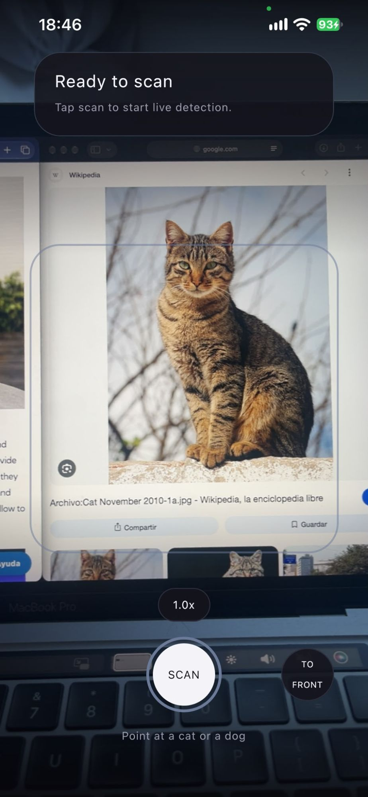
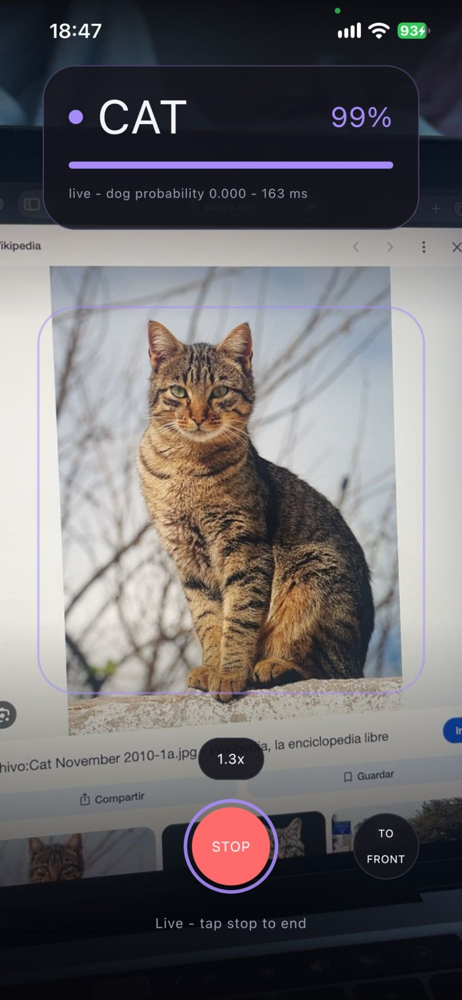
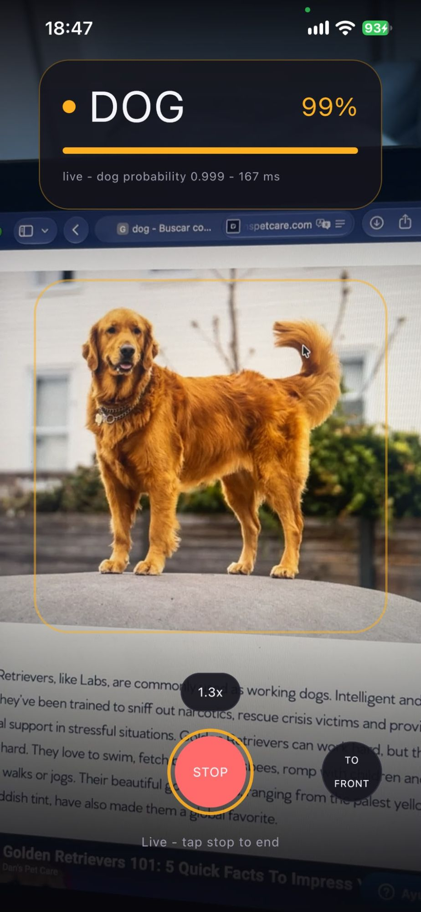
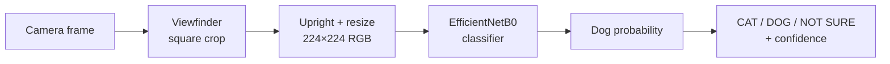

# ScannerCatDogs: on-device cat vs dog classification for Android & iOS

Point the camera at an animal and tell a cat from a dog in real time, **100 % on the device**: no server, no cloud
API, no network. One neural network, one Kotlin Multiplatform codebase, the same `.tflite` file on both platforms.


<table>
  <tr>
    <td align="center"><br><sub>Ready: model loaded on device</sub></td>
    <td align="center"><br><sub>Cat: label + confidence, live</sub></td>
    <td align="center"><br><sub>Dog: dog probability + latency</sub></td>
  </tr>
</table>

<sub>Running on an iPhone. The photos on screen are
<a href="https://commons.wikimedia.org/wiki/File:Cat_November_2010-1a.jpg">Cat November 2010-1a.jpg</a> (Wikimedia Commons)
and a golden retriever from
<a href="https://danspetcare.com/pets/an-extensive-guide-to-the-most-common-dogs">Dan's Pet Care</a>.</sub>

## Pipeline



1. **Camera.** Tap **SCAN** to start live scanning, **STOP** to end it. Each frame is cropped to the square
   viewfinder on screen and turned upright. Both cameras are supported, with pinch-to-zoom.
2. **Decision.** The model returns the dog probability `p` (trained in [classification_cat_dogs](https://github.com/freddmejia/classification_cat_dogs)). `p > 0.5` is a dog,
   otherwise a cat; the confidence is `p` or `1 - p`. Below 65 % the screen shows
   **NOT SURE**. The live result also shows the raw dog probability and the inference time.

The UI, the scanner states and the decision are shared Kotlin code; each platform only provides the TensorFlow Lite
runtime and the camera. Frames are processed in memory and never saved or uploaded.

> The model always answers *cat* or *dog*: it does not detect whether an animal is present, nor breeds or several
> animals at once.

## Stack

**Kotlin Multiplatform** · **Compose Multiplatform** · **LiteRT / TensorFlow Lite** · **CameraX** · **AVFoundation**

## Try it on your phone

```bash
git clone https://github.com/freddmejia/classification_cat_dogs_kmp_app.git
```

<table>
  <tr>
    <th>Android</th>
    <th>iOS</th>
  </tr>
  <tr>
    <td>Open the project in Android Studio, plug in your phone and press Run.<br><br>
      </td>
    <td>Open <code>iosApp/iosApp.xcodeproj</code> in Xcode, pick your Team and your iPhone, press Run.<br><br>
      </td>
  </tr>
</table>

## Docs

| | |
|---|---|
| [MODEL_CONTRACT.md](docs/MODEL_CONTRACT.md) | Model contract: tensors, preprocessing, decision, versioning and checksums (v1.0.0 baseline) |
| [BASELINE.md](docs/BASELINE.md) | How a `.tflite` runs from a KMP module on Android and iOS |
| [RESEARCH.md](docs/RESEARCH.md) | Library choices for the runtime and camera, and what was verified |
| [MODEL_PROTECTION.md](docs/MODEL_PROTECTION.md) | Options to protect the bundled model and obfuscate the app |
